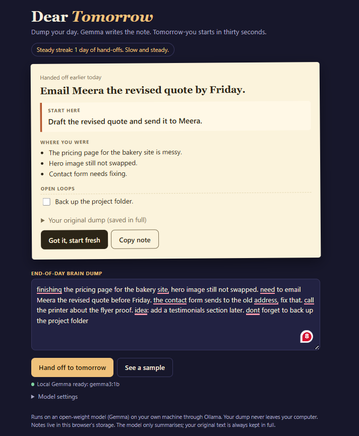
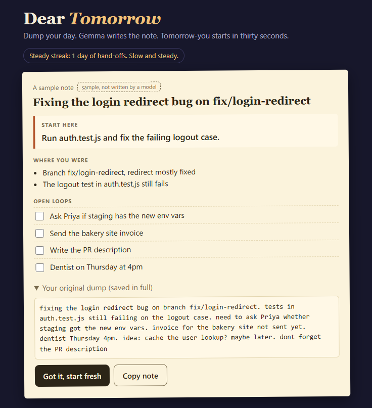
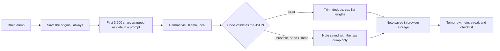

<div align="center">

# 🦥 Dear Tomorrow

### Dump your day. Gemma writes the note. Tomorrow-you starts in thirty seconds.
A lazy-in-the-right-way note-to-self, written by an open model on your own laptop. Your notes never leave your machine.

  -f0c27b) 



</div>

---

## Why this exists

The most expensive part of starting work is often remembering where you stopped. Which branch? Which test was failing? What did you promise to send? Rebuilding that context at 9am is dull, slow work that you did not need to do.

Dear Tomorrow does it the night before, while it's still in your head. Dump everything, however messy. Gemma turns it into a short note for tomorrow, and the note is waiting when you open the page.

Built for the **Hacktoberfest Open-Source AI Challenge, Week 3: Slow and Steady** (Oct 19-25, 2026). Started and finished within the challenge window.

## What it does

| | |
|---|---|
| 📝 **Dump** | One box. Notes, half-finished to-dos, branch names, error messages, things you almost forgot. |
| 🎯 **Start here** | One concrete first action for tomorrow, taken from your own words. |
| 🧭 **Where you were** | Up to three short facts to rebuild context. |
| 🔁 **Open loops** | Up to five unfinished things as a checklist. Tick them off tomorrow. |
| 🗂️ **Original dump** | Always saved in full and one click away, so the summary can never lose anything. |
| 📈 **Steady streak** | Counts consecutive days you handed off. It's worked out in code from the dates, not by the model. |
| 🗃️ **Past notes** | Replacing or clearing a note archives it (last 14 kept). |
| 🧪 **Sample** | "See a sample" shows a labelled example without a model. |

<p align="center">

</p>

## How it works



**The AI summarises. Code keeps the facts.**

- **The model's job is small:** summarise, don't judge. It returns a headline, one first action and two short lists.
- **Nothing is lost.** The raw dump is stored before the model is called, and it's what you see if the model is missing or returns something unusable.
- **Output is validated.** It needs a non-empty "start here". Lists are trimmed to strings, de-duplicated (case-insensitive) and capped at 3 and 5 items. Anything else is dropped.
- **Dates and streaks are code.** "Good morning" versus "from 4 days ago" and the streak count come from the stored dates. A missed day resets the streak, and today stays open until you hand off.
- **Everything the model writes is shown as plain text,** never as HTML.
- **Tested headlessly** in Chromium against a mocked Ollama with seeded dates: the full flow, reload persistence, next-morning view, streak maths, malformed output, no Ollama, blocked storage, long dumps, injection attempts and the phone layout (47 checks). That tests the app's logic, not Gemma's summary quality.

## Run it

You need [Ollama](https://ollama.com) and a browser (Chrome, Edge or Firefox).

```bash
ollama pull gemma3:1b
```

Serve the page from this folder (or use the VS Code Live Server extension):

```bash
python -m http.server 8000
```

Open <http://localhost:8000>. The status line should say **"Local Gemma ready"**. Use `python3` on Mac or Linux.

Ollama accepts requests from `http://localhost` by default, so nothing else is needed when you open the page that way. If you open it some other way (for example by double-clicking the file), start Ollama with browser access allowed:

```bash
# macOS / Linux
OLLAMA_ORIGINS="*" ollama serve

# Windows PowerShell
$env:OLLAMA_ORIGINS="*"; ollama serve
```

If you get "address already in use", Ollama is already running in the background. Quit it from the tray or menu bar and run the command again.

Under **Model settings** you can pick any installed model. A larger Gemma may summarise better.

## Honest limits

- **Summaries can miss or blur things.** Small models are especially prone to this. That's why the original dump is always saved and shown one click away. Read the note before you trust it.
- **"Start here" can be wrong.** It's the model's guess at your most concrete next action.
- **Only the first 3,500 characters go to the model** (Ollama's default context is small). The full dump is still saved, and the note says when it was cut.
- **Notes live in this browser's storage,** so they don't sync across devices and disappear if you clear site data. "Copy note" lets you paste a note elsewhere. If storage is blocked the page tells you.
- **Prompt injection isn't solved.** Text in your dump that tries to steer the model might partly work. The prompt tells the model to treat it as data, which helps but isn't a guarantee.
- **Not for sensitive secrets you wouldn't keep in a browser.** Notes are stored unencrypted in local storage.

## Why open models

A day's brain dump is private: client names, half-formed ideas, passwords you shouldn't have typed. Running an open-weight model locally means none of it is sent anywhere, it costs nothing per note, and it works offline on the train home. You can swap models without touching the code, and the model can't change under you overnight.

## Built with

Plain HTML/CSS/JS · [Ollama](https://ollama.com) · [Gemma](https://ai.google.dev/gemma) (provided under the [Gemma Terms of Use](https://ai.google.dev/gemma/terms))

Built within the challenge window with AI coding assistance.
